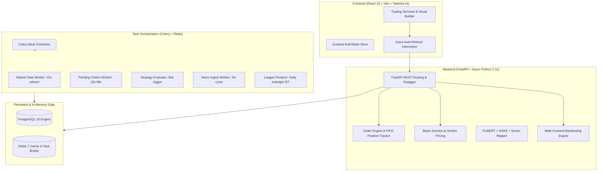

# TradeMind AI 🧠📈
### AI-Powered Event-Driven Paper Trading Platform
> **B.Tech Capstone Project | Data Science Engineering**  
> **G H Raisoni College of Engineering and Management** (Session: 2025–2026)

---

## 🌟 Executive Summary

**TradeMind AI** is an institutional-grade, event-driven simulated trading platform tailored for Indian financial markets (NSE). Combining natural language processing (NLP), quantitative options pricing, visual algorithmic strategy execution, and automated walk-forward backtesting, TradeMind AI provides retail traders and quantitative researchers with a zero-risk, high-fidelity sandbox.

The platform's flagship innovation is its **News Intelligence Engine**, which ingests Indian financial news in real time, scores sentiment using **FinBERT** and bilingual Indian financial lexicons, computes weighted multi-factor market impact scores, and directly controls running algorithmic strategies—tightening risk, adjusting position multipliers, or pausing trades automatically during volatile macroeconomic spikes.

---

## 🏗️ Architecture & Technology Stack



### Complete Technology Stack
- **Backend API**: Python 3.11, FastAPI, Pydantic v2
- **Database & ORM**: PostgreSQL 16, SQLAlchemy 2.0 (asyncio), asyncpg, Alembic migrations
- **Distributed Tasks & Caching**: Celery 5.4, Redis 7 (broker, price cache, JWT blacklist)
- **Frontend SPA**: React 19, Vite, Tailwind CSS v4, Zustand, Recharts, Axios
- **AI & NLP Pipeline**: 
  - `ProsusAI/finbert` (HuggingFace transformer, 110M parameters)
  - Bilingual Devanagari & transliterated Hindi financial sentiment lexicon
  - RAKE algorithm (`rake-nltk`) for sub-5ms keyword extraction
  - Custom expert-system sector mapping (63 stocks across 9 NIFTY sectors)
  - Claude 3.5 Sonnet / LLaMA 3.1 via OpenRouter for on-demand strategy & trade advisory
- **Quantitative Engine**: Black-Scholes European pricing model, analytical Greeks ($\Delta, \Gamma, \Theta, \text{Vega}$), synthetic implied volatility surface, futures carry model

---

## ⚡ Core Features

### 1. Simulated NSE Paper Trading Engine
- Realistic order execution models: `MARKET`, `LIMIT`, `SL` (Stop Loss), `TP` (Take Profit).
- Microstructure simulation: 0.05% adverse execution slippage model.
- Regulatory fee computation down to the paisa matching SEBI/NSE mandates: STT, stamp duty, exchange charges, SEBI turnover fees, GST (18%), and flat DP charges.
- Real-time signed position tracking with strict FIFO closing and virtual balance safeguards.

### 2. Event-Driven News Intelligence
- Continuous Google News RSS ingestion across 40 English and Hindi feeds.
- FinBERT signed expected polarity: $P(\text{positive}) - P(\text{negative})$; winning-class confidence is separate.
- Impact attenuates polarity by sector relevance, publisher credibility, and recency:
  $$\text{Impact} = \text{Polarity} \times S_{\text{sector}} \times S_{\text{source}} \times R$$
- Automated action engine:
  - **High Impact ($\ge 0.70$)**: Auto-pauses strategies, tightens stop losses, reduces lot sizing.
  - **Medium Impact ($0.40 - 0.70$)**: Generates in-app alerts, scales lot multipliers ($0.7\times$).
  - **Headline-count gate**: Requires $\ge 3$ recent articles before news actions; this is not a guarantee of independent corroboration.
  - **Manual Exit on News**: One-click position emergency liquidation tag (`USER_EXIT_NEWS`).

### 3. Visual Strategy Builder & Evaluator
- Recursive nested AND/OR condition tree with live JSON validation.
- Technical indicators: RSI (Wilder-smoothed), EMA, SMA, MACD, Volume SMA, Price, and News Sentiment.
- Multi-leg option support (CE/PE spreads, ATM/OTM strike selection, weekly/monthly expiries).
- Celery-driven edge-triggered evaluation loop firing simulated orders automatically.

### 4. Derivatives & F&O Terminal
- 384+ synthetic options and futures contracts dynamically derived from underlying spot.
- Interactive Option Chain displaying Bid/Ask, Greeks, Strike ladder, and Futures basis spread.
- Agnostic contract encoding (`{UNDERLYING}{DDMMM}{STRIKE}{CE|PE}`) seamlessly processed by order books.

### 5. Walk-Forward Backtesting Engine
- Replay engine simulating historical bars with strict look-ahead bias prevention (next-bar open execution).
- Walk-Forward Optimization (WFO) utilizing rolling 3-year in-sample train and 1-year out-of-sample test windows.
- Efficiency Ratio calculation:
  $$\text{Efficiency Ratio (ER)} = \frac{\text{Sharpe}_{\text{OOS}}}{\text{Sharpe}_{\text{IS}}}$$
  Identifies overfitted strategies ($\text{ER} \ge 0.70$ validated).

### 6. Trading League & Competitions
- Monthly and periodic trading challenges with fixed virtual capital.
- Leaderboards ranked dynamically by annualized Sharpe Ratio and win rate computed from filled orders.
- Badge reward system: 🥇 *Top Trader*, 🛡️ *Drawdown Master*, 📈 *Consistent Performer*, 📰 *News Ninja*, 🎯 *First Win*.
- Daily automated finalization via Celery beat.

---

## 🚀 Quickstart & Installation

### Option A: Local Development with Docker Compose

1. **Clone the repository**:
   ```bash
   git clone https://github.com/prashant5214/trademind-ai.git
   cd trademind-ai
   ```

2. **Configure Environment Variables**:
   ```bash
   cp backend/.env.example backend/.env
   ```

3. **Start all 6 services**:
   ```bash
   docker compose up -d --build
   ```

4. **Run Database Migrations**:
   ```bash
   docker compose exec backend alembic upgrade head
   ```

5. **Access Application**:
   - **Frontend UI**: [http://127.0.0.1:5173](http://127.0.0.1:5173)
   - **Backend API & Swagger Docs**: [http://127.0.0.1:8000/docs](http://127.0.0.1:8000/docs)

---

### Option B: Local Virtual Environment Setup

#### 1. Backend Setup
```bash
cd backend
python -m venv .venv
source .venv/bin/activate  # On Windows: .venv\Scripts\activate
pip install -r requirements.txt
alembic upgrade head
uvicorn app.main:app --host 0.0.0.0 --port 8000 --reload
```

#### 2. Start Celery Worker & Beat
```bash
# Terminal 1: Celery Worker (concurrency=2 recommended for local memory)
celery -A app.workers.celery_app worker --loglevel=info --concurrency=2

# Terminal 2: Celery Beat
celery -A app.workers.celery_app beat --loglevel=info
```

#### 3. Frontend Setup
```bash
cd frontend
npm install
npm run build
npm run preview -- --port 5173
```

---

## 🧪 Testing & Quality Assurance

Run the comprehensive pytest suite:
```bash
cd backend
pip install -r requirements-dev.txt
pytest tests/ -v --cov=app --cov-report=term-missing
```

Run load testing with Locust (50 simulated users):
```bash
cd backend
$env:LOCUST_AUTH_TOKEN = "<disposable-test-user-token>"
python -m locust -f locustfile.py --headless -u 50 -r 5 --run-time 2m --host http://localhost:8000
```
Without a token, the load script probes only `/health`. Order writes are
disabled unless `LOCUST_ENABLE_ORDER_WRITES=true`; enable them only against
an isolated test database and disposable paper-trading account.

Run frontend checks:
```bash
cd frontend
npm ci
npm run lint
npm run build
```

### Deployment configuration

The Render blueprint provisions the API, Redis, and PostgreSQL. Configure
`CORS_ORIGINS` on the backend as a JSON array containing the exact deployed
frontend origin, for example `["https://your-app.vercel.app"]`. Do not use
`*` when credentials are enabled.

Set `VITE_API_BASE_URL` in the Vercel project to the deployed API's `/api/v1`
base URL (for example, `https://your-api.onrender.com/api/v1`) and redeploy
the frontend. It defaults to `/api/v1` for local same-origin development.
Run `alembic upgrade head` against the production database before enabling
traffic. The deployment manifests do not contain production credentials;
configure provider secrets and service URLs in Render/Vercel before deploying.

---

## 📂 Repository Structure

```
trademind-ai/
├── backend/
│   ├── app/
│   │   ├── api/v1/         # REST API endpoints (auth, market, orders, strategies, news, league, backtest)
│   │   ├── models/         # SQLAlchemy 2.0 async models
│   │   ├── schemas/        # Pydantic v2 schemas and validators
│   │   ├── services/       # Core business logic (fees, F&O, news, backtesting, league)
│   │   ├── utils/          # Technical indicators, yfinance client
│   │   └── workers/        # Celery beat scheduler & background tasks
│   ├── migrations/         # Alembic database migrations
│   ├── tests/              # Pytest unit and integration test suite
│   ├── Dockerfile
│   └── requirements.txt
├── frontend/
│   ├── src/
│   │   ├── api/            # Axios API client modules
│   │   ├── components/     # UI widgets, layout, navigation, charts
│   │   ├── pages/          # Dashboard, Trading, F&O, Strategies, News, League, Profile
│   │   └── store/          # Zustand authentication store
│   ├── package.json
│   └── vite.config.js
├── docs/                   # Academic report, presentation deck, viva Q&A, API documentation
├── .github/workflows/      # Automated CI/CD workflow
├── docker-compose.yml
├── render.yaml             # Render cloud deployment blueprint
└── README.md
```

---

## 📜 Academic Credentials
- **Student**: Prashant (Department of Data Science Engineering)
- **Institution**: G H Raisoni College of Engineering and Management
- **Academic Session**: 2025–2026
- **License**: MIT Academic License
